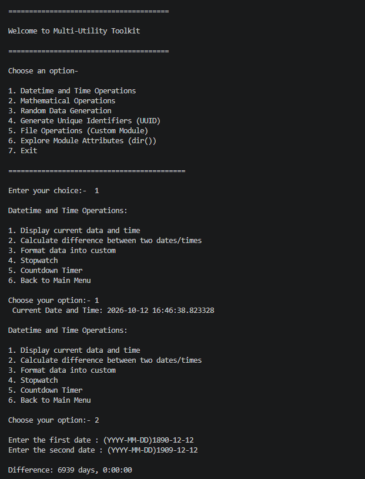

# Multi-Utility Toolkit

## Introduction

The **Multi-Utility Toolkit** is a menu-driven command-line application developed using Python. It brings together several useful utilities in a single program, allowing users to perform date and time calculations, mathematical operations, random data generation, UUID generation, file handling, and Python module exploration.

The project follows a modular programming approach by separating functionalities into different Python files inside a custom package. The `main.py` file acts as the entry point, while individual modules handle specific operations.

This project demonstrates the practical application of Python's built-in libraries, user-defined functions, loops, conditional statements, exception handling, file operations, and module management.

## Features

### 1. Date and Time Operations

This feature provides utilities for working with dates, times, and time intervals using Python's `datetime` and `time` modules.

Available operations:

- **Display Current Date and Time:** Displays the current date and time using `datetime.now()`.
- **Calculate Difference Between Two Dates:** Accepts two dates in `YYYY-MM-DD` format, calculates their difference, and displays the absolute time interval between them.
- **Display Formatted Date and Time:** Allows users to select and display the current date, current time, or complete date and time.
- **Stopwatch:** Measures the elapsed time between starting the stopwatch and pressing Enter to stop it.
- **Countdown Timer:** Accepts a number of seconds and displays a countdown, pausing for one second between each number.
- **Return to Main Menu:** Exits the date and time submenu.

### 2. Mathematical Operations

This feature performs mathematical calculations using Python's built-in `math` module and user-provided values.

Available operations:

- **Calculate Factorial:** Accepts an integer and calculates its factorial using `math.factorial()`.
- **Calculate Compound Interest:** Accepts the principal amount, annual interest rate, and time duration to calculate the final compounded amount.
- **Trigonometric Calculations:** Accepts an angle in degrees, converts it into radians using `math.radians()`, and calculates its sine and cosine.
- **Calculate Area of Geometric Shapes:** Provides the following options:
  - Area of a circle using the radius.
  - Area of a square using its side length.
  - Area of a rectangle using its length and width.
- **Return to Main Menu:** Allows users to exit the mathematical operations section.

The compound interest calculation uses the formula:

[
f= money\*(1+interest/100)\*\*year
]

Where:

- money = desired amount
- interest = rate of interest
- year = time duration

The program displays the final amount, rather than subtracting the principal to calculate interest earned separately.

### 3. Random Data Generation

This feature uses Python's `random` and `string` modules to generate random values and data.

Available operations:

- **Generate Random Number:** Generates a random integer between 1 and 100 using `random.randint()`.
- **Generate Random List:** Creates a predefined list containing `12, 34, 56, 78, 90`, shuffles its elements, and displays the resulting list.
- **Generate Random Password:** Generates a password of user-specified length using uppercase letters, lowercase letters, digits, and punctuation symbols.
- **Generate Random OTP:** Generates a six-digit random integer between 100000 and 999999.
- **Return to Main Menu:** Exits the random operations section.

The password generator combines the following character sets:

- `string.ascii_letters` — uppercase and lowercase letters.
- `string.digits` — numeric digits.
- `string.punctuation` — punctuation characters.

These characters are selected using `random.choices()` to generate a password of the requested length.

**Note:** In the current source code, the third menu option is labelled "Shuffle a List", but its implementation generates a random password. The description above reflects what the code actually executes.

### 4. UUID Generation

This feature generates universally unique identifiers using Python's `uuid` module.

Available operations:

- **Generate UUID:** Creates a UUID using the `uuid4()` function and displays the generated identifier.
- **Return to Main Menu:** Exits the UUID operations section.

UUIDs are useful for identifying records, resources, files, and objects without relying on simple sequential identifiers.

### 5. File Operations

This feature provides basic file management functionality through the custom `file_utils_module.py` module.

Available operations:

- **Create a File:** Accepts a filename and creates a new file using exclusive creation mode (`'x'`). If the file already exists, the program displays a message.
- **Write to a File:** Accepts a filename and content, then writes the content using write mode (`'w'`). Existing file content is overwritten.
- **Read from a File:** Opens an existing file in read mode (`'r'`), reads its contents, and displays them.
- **Append to a File:** Opens a file in append mode (`'a'`) and adds the supplied content to the end of the file.
- **Exit:** Returns control to the main menu.

The program uses Python's `open()` function and the `with` statement to work with files and automatically close them after operations.

The file creation and reading operations include exception handling for common file-related errors. The write and append operations currently do not include equivalent error handling.

### 6. Explore Python Module Attributes

This feature demonstrates how Python's built-in `dir()` function can be used to inspect the attributes available in different modules.

Available options:

- **Math Module:** Imports `math` and displays its available attributes and functions.
- **Random Module:** Imports `random` and displays its available attributes and functions.
- **String Module:** Imports `string` and displays its available attributes and functions.
- **UUID Module:** Imports `uuid` and displays its available attributes and functions.
- **Date/Time Module:** Imports `datetime` and displays its available attributes and functions.
- **Exit:** Returns to the main menu.

The (`dir()`) function is useful for exploring Python modules, discovering available methods, and understanding the structure of built-in libraries.

### 7. Main Menu and Navigation

The main menu is implemented in `main.py` using an infinite `while` loop and conditional statements.

Users can select from the following options:

1. Datetime and Time Operations
2. Mathematical Operations
3. Random Data Generation
4. Generate Unique Identifiers (UUID)
5. File Operations (Custom Module)
6. Explore Module Attributes (`dir()`)
7. Exit

The program calls the corresponding function based on the user's selection. Selecting option 7 displays an exit message and terminates the main loop using `break`.

If the user enters a menu number outside the supported options, the program displays a message asking for a valid choice.

## Project Structure

The project is organised into a main Python script and a custom package containing separate modules for different functionalities.

```text
/
│
├── main.py
├── output.png
├── README.md
│
└── package/
    ├── __init__.py
    ├── math_utils_module.py
    ├── file_utils_module.py
    └── explore_utils_module.py
```

### File Descriptions

#### `main.py`

The main entry point of the application.

Responsibilities:

- Imports the required functions from the custom `package`.
- Displays the main menu.
- Accepts the user's menu selection.
- Calls the appropriate function.
- Repeats the menu until the user chooses to exit.

#### `package/__init__.py`

Initialises the custom package and exposes the functions required by `main.py`.

It imports:

- `dt_operations`
- `math_operations`
- `random_operations`
- `uuid_operations`
- `file_operations`
- `dir_operations`

This allows the main program to import these functions directly from the package.

#### `package/math_utils_module.py`

Contains the date and time, mathematical, random data generation, and UUID operations.

Functions defined in this module:

| Function              | Description                                                                                         |
| --------------------- | --------------------------------------------------------------------------------------------------- |
| `dt_operations()`     | Performs date and time operations, including date differences, stopwatch timing, and countdowns.    |
| `math_operations()`   | Calculates factorials, compound amounts, trigonometric values, and geometric areas.                 |
| `random_operations()` | Generates random numbers, shuffles a predefined list, generates passwords, and creates random OTPs. |
| `uuid_operations()`   | Generates UUIDs using `uuid4()`.                                                                    |

Libraries imported by this module:

- `datetime` from the `datetime` module
- `time` and `sleep` from the `time` module, along with the `time` module itself
- `math`
- `random`
- `string`
- `uuid4` from the `uuid` module

#### `package/file_utils_module.py`

Contains the `file_operations()` function.

Responsibilities:

- Creating files.
- Writing content to files.
- Reading file contents.
- Appending content to files.
- Providing a menu to navigate between file operations.

#### `package/explore_utils_module.py`

Contains the `dir_operations()` function.

Responsibilities:

- Displaying the module exploration menu.
- Importing selected built-in modules.
- Using `dir()` to inspect module attributes.
- Allowing users to return to the main menu.

## Technologies Used

- **Programming Language:** Python
- **Development Tools:** Visual Studio Code (VS Code), terminal or command prompt
- **Version Control:** Git
- **Repository Hosting:** GitHub

### Python Libraries and Functions

The project uses Python's built-in libraries and functions, so no third-party packages are required.

| Library or Function | Purpose                                                              |
| ------------------- | -------------------------------------------------------------------- |
| `datetime`          | Working with dates and times                                         |
| `time`              | Measuring elapsed time and implementing countdown delays             |
| `math`              | Factorials, trigonometric calculations, and mathematical constants   |
| `random`            | Generating random numbers, selecting characters, and shuffling lists |
| `string`            | Providing letters, digits, and punctuation characters                |
| `uuid`              | Generating universally unique identifiers                            |
| `dir()`             | Exploring module attributes                                          |
| `open()`            | Creating, reading, writing, and appending to files                   |

## Requirements

Before running the project, ensure the following are available:

- Python 3.x installed on the system.
- Git&#x20;
- GitHub&#x20;
- Visual Studio Code or another Python-compatible editor (optional but recommended).

No external Python libraries or additional package installations are required.

## Installation and Execution

### 1. Install Python

Download and install Python 3.x from the official website:

[https://www.python.org/downloads/](https://www.python.org/downloads/)

Verify the installation by running:

```bash
python --version
```

On systems where the Python launcher is used, you can also run:

```bash
py --version
```

### 2. Clone the Repository

If the project is hosted on GitHub, clone it using:

```bash
git clone <repository-url>
```

Replace `<repository-url>` with the actual URL of your repository.

Alternatively, download the project files and extract them into a folder.

### 3. Open the Project Directory

Navigate to the project folder:

```bash
cd 
```

Open the folder in Visual Studio Code if desired:

```bash
code .
```

### 4. Run the Program

Execute the main Python file from the project root directory:

```bash
python main.py
```

Alternatively, on Windows:

```bash
py main.py
```

The main menu will appear in the terminal. Enter the number corresponding to the required operation and follow the prompts.

## Usage Guide

1. Start the program by running `main.py`.
2. Select an operation from the main menu.
3. Enter the requested numbers, dates, filenames, or other values.
4. View the result displayed in the terminal.
5. Use the relevant submenu's exit option to return to the main menu.
6. Select option 7 from the main menu to terminate the program.

For file operations, enter a filename that is accessible from the current working directory, or provide a valid relative or absolute path.

For date differences, enter dates in the `YYYY-MM-DD` format. For mathematical operations, provide valid numerical inputs.

## Concepts Demonstrated

This project applies several fundamental Python programming concepts:

- **Modular Programming:** Separating functionality into reusable modules.
- **Packages and Imports:** Organising Python files into a package and importing functions.
- **User-Defined Functions:** Creating functions for individual operations.
- **Loops:** Using `while` and `for` loops for menu navigation and countdowns.
- **Conditional Statements:** Using `if`, `elif`, and `else` to handle user selections.
- **User Input and Output:** Using `input()` and `print()` to interact with users.
- **Exception Handling:** Using `try` and `except` for selected file operations.
- **File Handling:** Using file modes to create, read, write, and append data.
- **Built-in Libraries:** Applying Python's standard library for practical tasks.
- **Mathematical Computation:** Implementing formulas and mathematical functions.
- **Randomisation:** Generating random values, passwords, and OTPs.
- **Module Inspection:** Exploring available attributes through `dir()`.
- **Time Measurement:** Measuring elapsed time and creating countdowns.

## Limitations

- The program uses terminal-based menus and does not provide a graphical user interface.
- Most menu inputs are converted directly to integers or numerical values, so invalid input types can raise exceptions.
- File writing and appending do not currently include explicit error handling.
- The OTP and password generators use the standard `random` module and are intended for educational demonstrations, not security-critical authentication.
- The random list operation shuffles a predefined list rather than accepting a custom list from the user.
- The mathematical operations menu handles one selected operation per call, while the geometric area submenu provides its own loop.
- Input validation and error handling can be improved to make the program more robust.


## Learning Objectives

The main objective of this project is to strengthen practical Python programming skills by combining multiple independent utilities into one application.

It provides hands-on experience with standard libraries, modular code organisation, file handling, mathematical calculations, random data generation, date and time manipulation, and interactive command-line programming.

-------
## Output

-------
## Author

## **Bhargav**



